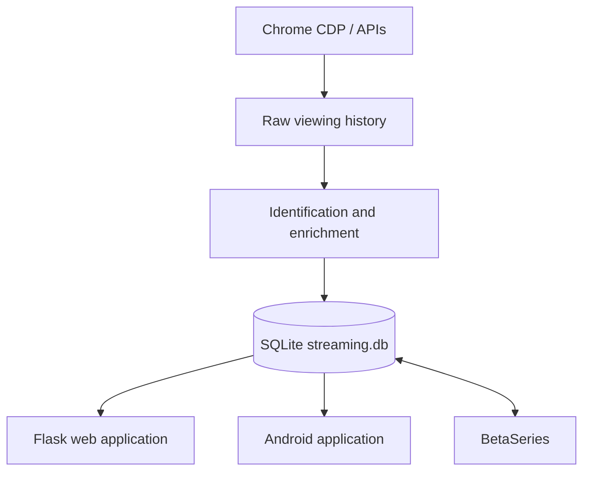

# StreamPilot — rpa_streaming

[Version française](README.md)

A local-first personal ingestion project that centralizes TV shows, movies, BetaSeries calendars, and viewing history from major streaming platforms available in France.

StreamPilot collects movies and TV shows, preserves raw data before identification, enriches titles with BetaSeries and IMDb, and exposes the resulting library through a Flask web application and an Android app. Multi-profile support maps profiles from different streaming platforms to shared meta-profiles.

## Features

- RPA ingestion through Chrome CDP, with full and differential modes;
- support for multiple streaming platforms and profiles;
- identification and enrichment through BetaSeries, IMDb, and Ollama;
- BetaSeries synchronization for shows, calendars, and viewing history;
- Flask web application with calendar, administration, and ingestion monitoring;
- Android application with offline cache, profiles, and ingestion controls;
- Docker deployment and Loki/Grafana observability;
- local SQLite storage, backups, and controlled deletion tools.



## Quick start

```bash
python tools/install_system_dependencies.py
cp .env.example .env
cp config/betaseries.example.json config/betaseries.local.json
cp config/ollama.example.json config/ollama.local.json
cp config/crunchyroll.example.json config/crunchyroll.local.json
cp config/streaming_profiles.example.json config/streaming_profiles.local.json
cp config/streaming_platforms.example.json config/streaming_platforms.local.json
cp config/streaming_platform_config.example.json config/streaming_platform_config.local.json
cp config/profile_matrix.example.json config/profile_matrix.local.json

# Fill in .env and config/*.local.json, then run:
python main_ingestion.py --cdp-url http://127.0.0.1:9222 --force-restart-chrome
flask --app web_app run --host 127.0.0.1 --port 5000
```

Open `http://127.0.0.1:5000`. Read the [installation](docs/installation.md) and [configuration](docs/configuration.md) guides before running your first real ingestion.

## Common commands

```bash
# Ingest all configured platforms
python main_ingestion.py --cdp-url http://127.0.0.1:9222 --cdp-timeout-ms 30000

# Restart Chrome with CDP and the extension when needed
python main_ingestion.py --cdp-url http://127.0.0.1:9222 --force-restart-chrome

# Differential mode
python main_ingestion.py --cdp-url http://127.0.0.1:9222 --rpa-mode differential

# Web application
flask --app web_app run --host 127.0.0.1 --port 5000

# Tests
python -m unittest discover -s tests
```

## Documentation

The detailed documentation is currently written in French:

- [Installation](docs/installation.md) — requirements, multi-OS setup, virtual environment, and Playwright.
- [Configuration](docs/configuration.md) — environment variables, local configuration, profiles, and security.
- [Usage](docs/usage.md) — ingestion, Chrome CDP, full/differential modes, and BetaSeries synchronization.
- [Web application and administration](docs/web-admin.md) — calendar, profiles, monitoring, and deletion.
- [Docker](docs/docker.md) — containerized web and RPA services.
- [Android application](docs/mobile.md) — synchronization, administration, and deep links.
- [Architecture](docs/architecture.md) — data flow, internal layers, and browser extension.
- [Connectors](docs/connectors.md) — platform-specific strategies and notes.
- [Observability](docs/observability.md) — logs, rotation, Loki, and Grafana.
- [Versioning and Git](docs/versioning.md), [GitFlow](docs/gitflow.md), and the [changelog](CHANGELOG.md).

## Preview


More screenshots are available in the [web application documentation](docs/web-admin.md#captures-decran).

## Security and personal data

- Never commit `.env`, `config/*.local.json`, or browser storage state files.
- Do not share `artifacts/rpa/`, `backups/`, or `logs/`: they may contain personal viewing history or session tokens.
- Review dry runs before using `--apply` for deletion or remote synchronization.
- This project is designed for local use. Do not expose its services without suitable authentication and network filtering.

## License

Personal project. No open-source license is currently declared.
