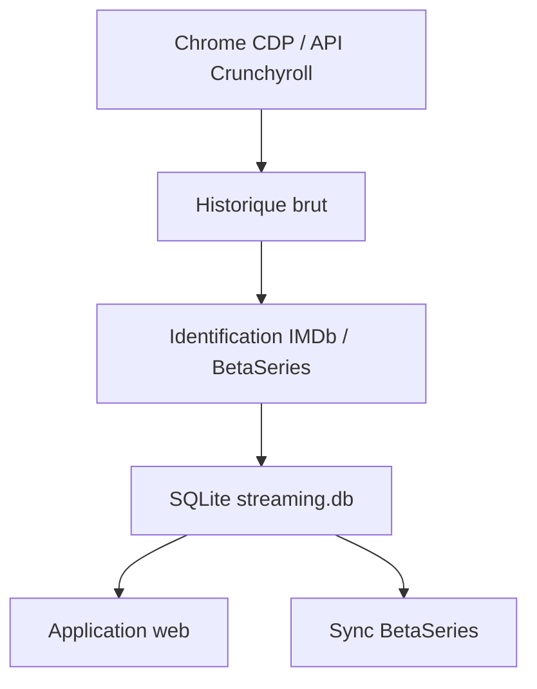

# rpa_streaming

Projet personnel d'ingestion locale pour centraliser les séries, films, calendriers BetaSeries et historiques de visionnage issus des plateformes de streaming disponibles en France.

Le flux collecte les films et les séries ensemble, conserve l'historique brut avant identification, enrichit les fiches avec BetaSeries/IMDb, puis expose les données dans l'application web Flask.



## Documentation

- [Installation](docs/installation.md) : prérequis, installation automatique multi-OS, venv et Playwright.
- [Configuration](docs/configuration.md) : `.env`, plateformes, credentials RPA, sécurité et limites.
- [Utilisation](docs/usage.md) : commandes d'ingestion, Chrome CDP, modes full/différentiel, enrichissement et sync BetaSeries.
- [Application web et administration](docs/web-admin.md) : vues calendrier/admin et suppression locale/distante.
- [Architecture](docs/architecture.md) : schéma de flux, couches internes et extension navigateur.
- [Connecteurs](docs/connectors.md) : stratégies par plateforme et notes API/RPA.
- [Logs et observabilité](docs/observability.md) : fichiers logs, rotation, Grafana/Loki.
- [Vue d'ensemble détaillée](docs/overview.md) : principes de collecte et qualité des données.
- [Changelog](CHANGELOG.md) : historique des changements notables.

## Aperçu de l'application web


Plus de captures : [Application web et administration](docs/web-admin.md#captures-decran).

## Démarrage rapide

```bash
python tools/install_system_dependencies.py
cp .env.example .env
# renseigner .env, puis :
python main_ingestion.py --cdp-url http://127.0.0.1:9222 --force-restart-chrome
flask --app web_app run --host 127.0.0.1 --port 5000
```

## Commandes courantes

```bash
# Toutes les plateformes configurées
python main_ingestion.py --cdp-url http://127.0.0.1:9222 --cdp-timeout-ms 30000

# Redémarrer Chrome automatiquement avec CDP + extension si nécessaire
python main_ingestion.py --cdp-url http://127.0.0.1:9222 --force-restart-chrome

# Mode différentiel
python main_ingestion.py --cdp-url http://127.0.0.1:9222 --rpa-mode differential

# Application web
flask --app web_app run --host 127.0.0.1 --port 5000

# Tests
python -m unittest discover -s tests
```

## Règles de sécurité

- Ne commit jamais `.env`.
- Ne partage pas `artifacts/rpa`, `backups/` ou `logs/` si ces fichiers contiennent ton historique personnel.
- Utilise `--apply` uniquement après inspection des dry-runs pour les scripts de suppression ou de synchronisation distante.
