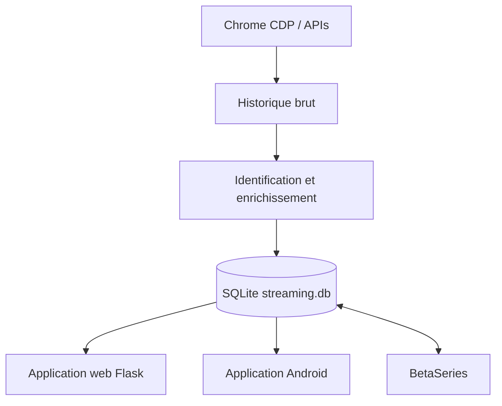

# StreamPilot — rpa_streaming

[English version](README.en.md)

Projet personnel d’ingestion locale qui centralise les séries, films, calendriers BetaSeries et historiques de visionnage provenant des principales plateformes de streaming disponibles en France.

StreamPilot collecte les films et les séries, conserve les données brutes avant leur identification, enrichit les fiches avec BetaSeries et IMDb, puis les expose dans une application web Flask et une application Android. La gestion multi-profil permet d’associer les profils des différentes plateformes à des méta-profils communs.

## Fonctionnalités

- ingestion RPA via Chrome CDP, avec modes complet et différentiel ;
- prise en charge de plusieurs plateformes et profils de streaming ;
- identification et enrichissement via BetaSeries, IMDb et Ollama ;
- synchronisation des séries, calendriers et historiques avec BetaSeries ;
- application web Flask avec calendrier, administration et suivi des ingestions ;
- application Android avec cache hors ligne, profils et relance des ingestions ;
- déploiement Docker et observabilité avec Loki/Grafana ;
- stockage local SQLite, sauvegardes et outils de suppression contrôlée.



## Démarrage rapide

```bash
python tools/install_system_dependencies.py
cp .env.example .env
cp config/betaseries.example.json config/betaseries.local.json
cp config/ollama.example.json config/ollama.local.json
cp config/crunchyroll.example.json config/crunchyroll.local.json
cp config/streaming_profiles.example.json config/streaming_profiles.local.json
cp config/streaming_platforms.example.json config/streaming_platforms.local.json
cp config/streaming_platform_config.example.json config/streaming_platform_config.local.json
cp config/profile_matrix.example.json config/profile_matrix.local.json

# Renseigner .env et les fichiers config/*.local.json, puis :
python main_ingestion.py --cdp-url http://127.0.0.1:9222 --force-restart-chrome
flask --app web_app run --host 127.0.0.1 --port 5000
```

Ouvre ensuite `http://127.0.0.1:5000`. Consulte le guide d’[installation](docs/installation.md) et de [configuration](docs/configuration.md) avant une première ingestion réelle.

## Commandes courantes

```bash
# Toutes les plateformes configurées
python main_ingestion.py --cdp-url http://127.0.0.1:9222 --cdp-timeout-ms 30000

# Redémarrer Chrome avec CDP et l’extension si nécessaire
python main_ingestion.py --cdp-url http://127.0.0.1:9222 --force-restart-chrome

# Mode différentiel
python main_ingestion.py --cdp-url http://127.0.0.1:9222 --rpa-mode differential

# Application web
flask --app web_app run --host 127.0.0.1 --port 5000

# Tests
python -m unittest discover -s tests
```

## Documentation

- [Installation](docs/installation.md) — prérequis, installation multi-OS, environnement virtuel et Playwright.
- [Configuration](docs/configuration.md) — variables d’environnement, configurations locales, profils et sécurité.
- [Utilisation](docs/usage.md) — ingestion, Chrome CDP, modes complet/différentiel et synchronisation BetaSeries.
- [Application web et administration](docs/web-admin.md) — calendrier, profils, suivi et suppressions.
- [Docker](docs/docker.md) — services web et RPA conteneurisés.
- [Application Android](docs/mobile.md) — synchronisation, administration et liens profonds.
- [Architecture](docs/architecture.md) — flux de données, couches internes et extension navigateur.
- [Connecteurs](docs/connectors.md) — stratégies et particularités de chaque plateforme.
- [Observabilité](docs/observability.md) — logs, rotation, Loki et Grafana.
- [Versioning et Git](docs/versioning.md) et [GitFlow](docs/gitflow.md).
- [Vue d’ensemble](docs/overview.md) et [changelog](CHANGELOG.md).

## Aperçu


Davantage de captures sont disponibles dans la documentation de l’[application web](docs/web-admin.md#captures-decran).

## Sécurité et données personnelles

- Ne jamais commiter `.env`, `config/*.local.json` ou un état de navigateur.
- Ne pas partager `artifacts/rpa/`, `backups/` ou `logs/` : ils peuvent contenir un historique personnel ou des jetons de session.
- Inspecter les dry-runs avant d’utiliser `--apply` pour une suppression ou une synchronisation distante.
- Le projet est prévu pour un usage local : ne pas exposer les services sans authentification et filtrage réseau adaptés.

## Licence

Projet personnel. Aucune licence open source n’est actuellement déclarée.
