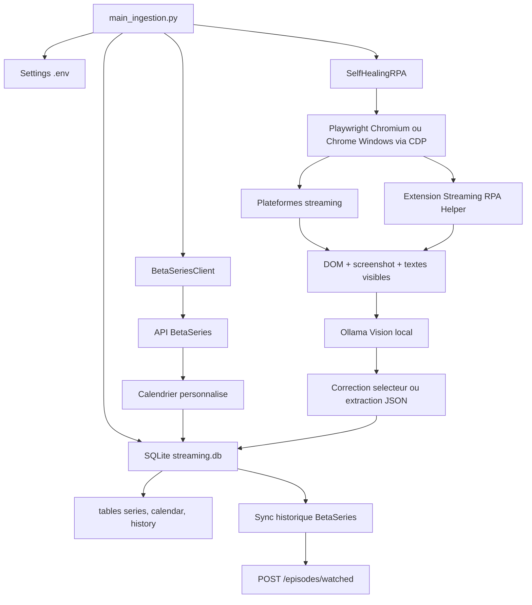

# rpa_streaming

Projet personnel d'ingestion locale pour centraliser le calendrier BetaSeries, les séries suivies et les historiques de visionnage issus des plateformes de streaming disponibles en France.

Le projet combine trois approches:

- API officielle BetaSeries pour le calendrier personnalisé, la watchlist et les diffuseurs.
- API non officielles quand elles sont réalistes et maintenues, notamment Crunchyroll.
- RPA Playwright self-healing pour les plateformes sans API exploitable.

Disney+ collecte uniquement les cartes du rail « Continuer à regarder », avec
leur titre complet, les libelles accessibles et le lien de lecture. Les
recommandations et marques de la page d'accueil ne constituent pas un
historique. Un titre Ollama sans correspondance verifiable est ignore avec un
avertissement; les autres titres valides sont conserves. Une carte « Episode
suivant » ne confirme pas le visionnage de cet episode : son numero reste
inconnu. Cette collecte fournit un etat de reprise, pas un historique exhaustif.

CANAL+ collecte les cartes du rail « Continuer la lecture », y compris les
contenus disponibles via Apple TV+, Max, Paramount+ et OCS dans cette session.
La playlist et les recommandations ne sont pas interpretees comme du visionnage.
Les rails Disney+ et CANAL+ utilisent `rpa.strict_history_scope=true` : une
reparation des lignes doit rester dans leur conteneur verifie. Une absence de
rail ne declenche pas une extraction generale des liens de l'accueil. Les titres
vides ou non verifiables sont ignores individuellement. Si la capture d'ecran
depasse 15 secondes, le DOM est tout de meme enregistre pour l'extraction texte.

Crunchyroll cible `.history-body` et les cartes `history-playable-card` de la
liste virtualisee. L'attente utilise `selector_state=attached`, puis les
titres des liens de series, les titres d'episodes et la date de chaque carte
sont lus dans le DOM. La date affichee est convertie de JJ/MM/AAAA en ISO; le
numero E4 est conserve comme episode 4. Si la saison n'est pas indiquee, elle
reste inconnue. Les liens de lecture sont conserves. Le collecteur defile dans
la liste virtualisee et conserve les cartes avant qu'elles ne quittent le DOM.
Il s'arrete au bas de la liste apres trois passages sans nouvelle carte.
`rpa.max_scroll_steps` (500) borne le parcours et `rpa.scroll_wait_ms` (750)
laisse charger les cartes. Si la limite est atteinte, un avertissement signale
une collecte partielle; augmenter ces valeurs dans la configuration si besoin.
Les cartes Crunchyroll sont extraites directement du DOM, sans interpretation
Ollama. L'identifiant de serie, les anciens titres et les liens d'episodes
permettent de conserver le rattachement apres un renommage BetaSeries.

La fiche affiche « Episodes vus X sur Y » : X compte les episodes distincts,
pas les relectures; les lectures en cours restent visibles dans l'historique
sans augmenter X. Y provient des metadonnees `episodes_count` BetaSeries.
Sans total disponible, la fiche indique « total inconnu ». Une serie suivie
mais jamais visionnee peut legitimement ne pas avoir d'historique.

Reparation locale depuis les captures HTML deja enregistrees, sans connexion
aux plateformes ni synchronisation BetaSeries :

```bash
python -m tools.repair_crunchyroll_history          # previsualisation
python -m tools.repair_crunchyroll_history --apply  # sauvegarde puis import
```

L'outil requiert Chromium Playwright (`python -m playwright install chromium`).
La sauvegarde SQLite est creee dans `backups/` avant toute modification.

Execution RPA Crunchyroll seule, sans synchronisation BetaSeries :

```bash
python main_ingestion.py --platform crunchyroll \
  --cdp-url http://127.0.0.1:9222 --skip-betaseries --skip-crunchyroll-api
```

Puis enrichir les nouvelles fiches pour obtenir le total d'episodes et les
titres BetaSeries (ne marque aucun episode comme vu sur le compte distant) :

```bash
python -m tools.enrich_betaseries_metadata --platform crunchyroll --limit 500 --skip-calendar
```

Redemarrer le serveur web s'il a ete lance sans rechargement automatique :

```bash
flask --app web_app run --host 127.0.0.1 --port 5000
```

Execution du connecteur API Crunchyroll seul :

```bash
python main_ingestion.py --platform crunchyroll --skip-rpa --skip-betaseries
```

## Calendrier web

La vue `/calendar` affiche les prochaines sorties connues dans SQLite, par
mois. Les cases a cocher permettent de combiner plusieurs plateformes; sans
selection, toutes sont affichees. Les filtres sont conserves lors du passage
au mois precedent ou suivant. Chaque episode ouvre la fiche de sa serie.
Sur mobile, les sorties sont regroupees par jour plutot que dans une grille.
Les dates passees et les episodes sans date ne sont pas affiches. La date du
jour utilise le fuseau Europe/Paris. Les dates sont celles du calendrier
enregistre, pas une garantie de disponibilite locale sur la plateforme.

Cette vue ne lance aucune synchronisation. Pour voir de nouvelles dates,
mettre a jour le calendrier via l'ingestion BetaSeries existante puis
actualiser la page. Redemarrer Flask apres une modification du code si le
serveur tourne sans rechargement automatique.

## Etat des connecteurs

| Plateforme | Stratégie | Config | Variables utiles |
| --- | --- | --- | --- |
| BetaSeries | API officielle | `.env` | `BETASERIES_API_KEY`, `BETASERIES_CLIENT_SECRET`, `BETASERIES_ACCESS_TOKEN`, `BETASERIES_USER_ID` optionnel |
| Crunchyroll | API non officielle puis RPA secours | `config/platforms/crunchyroll.json` | `CRUNCHYROLL_EMAIL`, `CRUNCHYROLL_PASSWORD`, `CRUNCHYROLL_PROFILE_ID`, `CRUNCHYROLL_LOCALE` |
| Netflix | RPA | `config/platforms/netflix.json` | Connexion via navigateur persistant |
| Prime Video | RPA | `config/platforms/prime_video.json` | Connexion via navigateur persistant |
| Disney+ | RPA + extension helper | `config/platforms/disney_plus.json` | Connexion via navigateur persistant |
| CANAL+ | RPA + extension helper | `config/platforms/canal_plus.json` | Connexion via navigateur persistant |
| Apple TV+ | Via CANAL+ | `config/platforms/canal_plus.json` | Compte CANAL+ |
| HBO Max / Max | Via CANAL+ | `config/platforms/canal_plus.json` | Compte CANAL+ |
| Paramount+ | Via CANAL+ | `config/platforms/canal_plus.json` | Compte CANAL+ |
| OCS | Via CANAL+ | `config/platforms/canal_plus.json` | Compte CANAL+ |

## Architecture

## Administration et suppression

La page `/admin` permet de supprimer une série de la base locale. La
confirmation exige de saisir `SUPPRIMER`; une copie SQLite horodatée est
créée dans `backups/` avant l'opération. Cette action ne modifie aucun compte
de streaming et ne désabonne pas la série de BetaSeries.

Pour demander la suppression de l'historique sur les plateformes connectées,
le script RPA fonctionne en aperçu par défaut. Il ouvre les pages configurées,
repère les cartes dont le titre correspond exactement au titre fourni, et
enregistre une capture HTML. Aucun bouton n'est cliqué en mode aperçu :

```bash
python -m tools.delete_series_history_rpa \
  --title "Clevatess" \
  --platform crunchyroll \
  --cdp-url http://127.0.0.1:9222
```

Après vérification des artefacts dans `artifacts/rpa/delete-history/`, une
suppression distante peut être demandée ainsi :

```bash
python -m tools.delete_series_history_rpa \
  --title "Clevatess" \
  --platform crunchyroll \
  --cdp-url http://127.0.0.1:9222 \
  --apply --confirm-title "Clevatess"
```

Répéter `--platform` pour plusieurs services. Les plateformes ne proposant
pas de bouton de suppression identifiable sont signalées et ignorées; le
script ne supprime pas une carte simplement parce qu'elle contient un lien.
Cette opération dépend de l'interface et des droits du compte, et ne garantit
pas l'effacement côté fournisseur. Le script exclut Arte, conformément à la
configuration active.

```text
.
├── browser_extension/
│   └── streaming-rpa-helper/
│       ├── content.js
│       └── manifest.json
├── config/
│   ├── platforms.example.json
│   └── platforms/
│       ├── apple_tv_plus.json
│       ├── arte_tv.json
│       ├── canal_plus.json
│       ├── crunchyroll.json
│       ├── disney_plus.json
│       ├── max.json
│       ├── netflix.json
│       ├── ocs.json
│       ├── paramount_plus.json
│       └── prime_video.json
├── ingestion/
│   ├── betaseries_client.py
│   ├── db.py
│   ├── ollama_client.py
│   ├── rpa_self_healing.py
│   └── settings.py
├── .env
├── .env.example
├── main_ingestion.py
└── requirements.txt
```

## Schema de flux



## Plan d'architecture

### Couche orchestration

`main_ingestion.py` initialise la configuration, crée le schéma SQLite, lance BetaSeries puis les connecteurs RPA. Les pauses entre flux évitent les enchaînements trop agressifs.

### Couche stockage

`ingestion/db.py` fournit une API SQLite simple:

- `series`: référentiel local des séries.
- `calendar`: épisodes planifiés via BetaSeries.
- `history`: épisodes vus par plateforme.

La table `history` contient les champs demandés: `id`, `serie_id`, `saison`, `episode`, `date_vu`, `plateforme_source`, avec des colonnes de traçabilité (`raw_title`, `confidence`, `created_at`).

Elle contient aussi des champs de synchronisation BetaSeries: `betaseries_episode_id`, `sync_status`, `betaseries_synced_at` et `sync_error`. Ces champs permettent de garder une trace claire entre ce qui a été vu sur les plateformes, ce qui a été reconnu localement et ce qui a réellement été envoyé à BetaSeries.

### Couche BetaSeries

`ingestion/betaseries_client.py` appelle l'API officielle BetaSeries et upsert les épisodes du calendrier personnalisé. Les variables nécessaires sont:

```text
BETASERIES_API_KEY=
BETASERIES_CLIENT_SECRET=
BETASERIES_ACCESS_TOKEN=
BETASERIES_USER_ID=
```

`BETASERIES_CLIENT_SECRET` correspond à la `oauth2 key` fournie avec la clé API. `BETASERIES_ACCESS_TOKEN` doit être un token membre obtenu après authentification OAuth; la `oauth2 key` ne suffit pas pour les endpoints utilisateur. Si `BETASERIES_USER_ID` est vide, le client tente de résoudre l'utilisateur via `/members/infos`.

Pour obtenir un token utilisateur avec le device flow:

```bash
. .venv/bin/activate
python tools/betaseries_device_auth.py
```

Le script affiche une URL BetaSeries, un code à saisir, puis la valeur `BETASERIES_ACCESS_TOKEN` à recopier dans `.env`.

### Couche RPA self-healing

`ingestion/rpa_self_healing.py` utilise Playwright avec un profil persistant dans `.playwright-profile`, ou le contexte Chrome Windows via CDP. Ce profil conserve les cookies et évite de stocker les mots de passe des plateformes.

Apple TV+, Max, Paramount+ et OCS sont accessibles dans l'offre CANAL+ du
compte utilisateur. Ils ne sont donc pas lancés comme des plateformes
indépendantes : le connecteur `canal_plus` collecte les contenus visibles dans
la session CANAL+ et les enregistre avec `plateforme_source=canal_plus`.

En cas d'échec d'un sélecteur:

1. Capture d'écran de la page courante.
2. Extraction du DOM brut.
3. Appel à Ollama local via `http://localhost:11434/api/chat`.
4. Demande d'un nouveau sélecteur au modèle vision.
5. Mise à jour du sélecteur en mémoire et reprise du flux.

### Extension navigateur optionnelle

Le dossier `browser_extension/streaming-rpa-helper` contient une extension Chromium Manifest V3. Elle injecte un content script sur les plateformes très dynamiques pour exposer:

```javascript
window.__STREAMING_RPA_HELPER__.collectCandidates()
```

Le RPA récupère ces candidats DOM et les ajoute au prompt Ollama. L'extension ne sort aucune donnée du navigateur; elle sert uniquement l'exécution Playwright locale.

Le dossier `browser_extension/crunchyroll-token-helper` contient une seconde extension locale optionnelle. Elle capture uniquement le header `Authorization: Basic ...` envoyé par le site Crunchyroll vers `https://beta-api.crunchyroll.com/auth/v1/token`. Ce header est nécessaire si le client embarqué du wrapper Python `CrunchyrollAPI` est désactivé côté Crunchyroll.

Utilisation:

1. Ouvre Chromium ou Chrome.
2. Va dans `chrome://extensions`.
3. Active le mode développeur.
4. Charge le dossier `browser_extension/crunchyroll-token-helper`.
5. Connecte-toi à Crunchyroll.
6. Ouvre le popup de l'extension et copie la ligne `CRUNCHYROLL_AUTHORIZATION=...` dans `.env`.

## Prérequis

- Python 3.10 ou supérieur.
- SQLite, inclus avec Python.
- Ollama installé localement.
- Un modèle Ollama vision, par exemple `llava:latest`.
- Un compte BetaSeries avec clé API.
- Comptes personnels sur les plateformes que tu veux synchroniser.
- Chromium Playwright.

## Installation

```bash
python -m venv .venv
source .venv/bin/activate
pip install -r requirements.txt
playwright install chromium
ollama pull llava:latest
```

Le fichier `.env` est généré avec des valeurs vides. Renseigne au minimum:

```text
BETASERIES_API_KEY=
BETASERIES_ACCESS_TOKEN=
OLLAMA_MODEL=gemma3:4b
OLLAMA_BASE_URL=http://localhost:11434
```

Pour Crunchyroll via API non officielle:

```text
CRUNCHYROLL_EMAIL=
CRUNCHYROLL_PASSWORD=
CRUNCHYROLL_AUTHORIZATION=
CRUNCHYROLL_PROFILE_ID=
CRUNCHYROLL_LOCALE=fr-FR
```

## Configuration des plateformes

L'index `config/platforms.example.json` liste les fichiers actifs:

```json
[
  "config/platforms/netflix.json",
  "config/platforms/prime_video.json",
  "config/platforms/disney_plus.json"
]
```

Tu peux créer ton propre index:

```bash
cp config/platforms.example.json config/platforms.local.json
```

Puis modifier `.env`:

```text
PLATFORM_CONFIG_PATH=config/platforms.local.json
```

Chaque fichier plateforme contient:

- `strategy`: `rpa`, `api_then_rpa` ou futur `api`.
- `api`: disponibilité, variables attendues et notes.
- `rpa.start_url`: URL de départ.
- `rpa.wait_after_login_seconds`: délai pour laisser finir login, redirections et hydratation JS.
- `rpa.requires_browser_extension`: charge l'extension helper si nécessaire.
- `rpa.selectors`: sélecteurs initiaux avant self-healing.

## Execution

### Connexion a Chrome Windows via CDP

Le mode CDP permet au RPA de reutiliser l'instance Chrome Windows deja
connectee aux plateformes. Playwright ouvre des onglets dans le contexte Chrome
existant et ne gere pas les cookies lui-meme.

Ferme d'abord toutes les fenetres Chrome Windows, puis lance PowerShell :

```powershell
$chrome = "$env:ProgramFiles\Google\Chrome\Application\chrome.exe"
Start-Process $chrome -ArgumentList '--remote-debugging-port=9222','--remote-allow-origins=*'
```

Si Chrome est installe dans le dossier utilisateur :

```powershell
$chrome = "$env:LOCALAPPDATA\Google\Chrome\Application\chrome.exe"
Start-Process $chrome -ArgumentList '--remote-debugging-port=9222','--remote-allow-origins=*'
```

Reconnecte-toi ensuite aux plateformes dans cette fenetre Chrome. Depuis WSL,
verifie le port :

```bash
curl http://127.0.0.1:9222/json/version
```

Lance ensuite le RPA en mode CDP :

```bash
cd /home/chris/rpa_streaming
source .venv/bin/activate
python main_ingestion.py \
  --cdp-url http://127.0.0.1:9222 \
  --skip-betaseries \
  --skip-crunchyroll-api
```

Pour lancer BetaSeries, Crunchyroll et le RPA dans le meme flux :

```bash
python main_ingestion.py \
  --cdp-url http://127.0.0.1:9222 \
  --betaseries-days-before 30 \
  --betaseries-days-after 365
```

Le reglage peut aussi etre place dans `.env` :

```dotenv
RPA_CDP_URL=http://127.0.0.1:9222
```

Le self-healing et l'extraction de donnees utilisent Ollama. `llava:latest`
peut boucler sur les captures complexes et ne pas produire le JSON attendu.
Le modele configure est `gemma3:4b`. Il est deja installe sur cette machine et
a produit un JSON valide sur un test d'extraction des six lignes Prime Video.
`qwen2.5vl:7b` reste configurable, mais la lecture de la capture a produit des
resultats inexacts dans les tests locaux :

```bash
ollama serve
ollama pull gemma3:4b
curl http://127.0.0.1:11434/api/tags
```

Dans `.env`, configure :

```dotenv
OLLAMA_MODEL=gemma3:4b
```

Reglages utilises par chaque requete (dans `.env`) :

```dotenv
OLLAMA_NUM_CTX=32768
OLLAMA_NUM_PREDICT=4096
OLLAMA_TIMEOUT=300
```

`NUM_CTX` borne le contexte d'entree; `NUM_PREDICT` borne la sortie. Le
self-healing utilise 768 tokens de sortie et l'extraction procede par lots de
dix lignes. Le client agrege les messages NDJSON du serveur et conserve un
schema JSON explicite lors des nouvelles tentatives. Les balises script/style
sont retirees du DOM transmis. Les lignes DOM sont prioritaires lorsqu'elles
existent; la vision est utilisee quand il n'y a pas de lignes textuelles.

Diagnostic sans modification de la base ni synchronisation BetaSeries :

```bash
python -m tools.ollama_diagnostics
python -m tools.ollama_diagnostics --image artifacts/rpa/prime_video/CAPTURE.png
```

Le second test affiche un titre lu dans l'image; compare-le avec la capture.
Une reponse JSON valide ne garantit pas une lecture visuelle exacte. Les logs
indiquent le modele reel, les budgets, les compteurs de tokens et la raison
d'arret. Si la sortie est tronquee, reduis les lots ou augmente le budget de
sortie. Augmenter seulement le contexte ne corrige pas une boucle de generation.

Le test `/api/tags` doit retourner un JSON contenant `gemma3:4b`. Si Ollama
tourne sous Windows et non dans WSL, remplace `OLLAMA_BASE_URL` dans `.env` par
l'adresse de l'hote Windows accessible depuis WSL, par exemple
`http://$(ip route | awk '/default/ {print $3}'):11434`, puis relance le test.
Une erreur HTTP 404 sur `/api/chat` indique que le port cible n'est pas le
serveur Ollama attendu.

`--cdp-url` est prioritaire sur `.env`. Sans URL CDP, Playwright conserve son
comportement historique et lance un Chromium persistant avec
`RPA_USER_DATA_DIR`.

Une extension ne peut pas etre injectee dynamiquement dans un contexte Chrome
deja ouvert via CDP. Pour les plateformes utilisant
`streaming-rpa-helper`, installe l'extension une fois dans Chrome via
`chrome://extensions`, active le mode developpeur et charge le dossier
`browser_extension/streaming-rpa-helper`. Le RPA CDP reutilisera cette
extension deja installee.

Synchronisation complète:

```bash
python main_ingestion.py
```

Uniquement BetaSeries:

```bash
python main_ingestion.py --skip-rpa
```

Avec une fenêtre de calendrier plus large:

```bash
python main_ingestion.py --skip-rpa --betaseries-days-before 365 --betaseries-days-after 365
```

Uniquement RPA:

```bash
python main_ingestion.py --skip-betaseries
```

Mode headless après stabilisation des connexions:

```bash
python main_ingestion.py --skip-betaseries --headless
```

## Synchroniser l'historique vers BetaSeries

Les plateformes exposent des niveaux de précision différents:

- Crunchyroll donne souvent un vrai couple série/saison/épisode via l'historique visible.
- Netflix et Prime Video exposent l'historique web, mais les détails épisode peuvent demander une extraction plus fine page par page.
- Disney+ expose surtout l'état "Continuer à regarder"; ce n'est pas toujours un historique complet.
- CANAL+ donne des rails récents et des états de reprise, selon les pages et le profil.

Le projet synchronise donc uniquement les lignes fiables: il faut au minimum `saison` et `episode`, puis l'outil recherche la série dans BetaSeries, récupère ses épisodes et vérifie le couple saison/épisode avant tout envoi.

Dry-run, sans écriture sur le compte BetaSeries:

```bash
python -m tools.sync_history_to_betaseries --limit 50
```

Limiter à une plateforme:

```bash
python -m tools.sync_history_to_betaseries --platform crunchyroll --limit 100
```

Envoyer réellement les épisodes reconnus à BetaSeries:

```bash
python -m tools.sync_history_to_betaseries --platform crunchyroll --apply
```

Marquer aussi les épisodes précédents comme vus côté BetaSeries:

```bash
python -m tools.sync_history_to_betaseries --platform crunchyroll --apply --bulk
```

L'API BetaSeries utilisée est `POST /episodes/watched`. Par sécurité, `--apply` n'est jamais implicite.

Enrichir les séries locales avec les posters, synopsis et calendriers BetaSeries:

```bash
python -m tools.enrich_betaseries_metadata --limit 140 --calendar-days-after 365
```

Enrichir en fallback IMDb les titres qui restent pauvres ou absents de BetaSeries:

```bash
python -m tools.enrich_imdb_metadata --limit 200
```

Limiter le fallback IMDb à une plateforme:

```bash
python -m tools.enrich_imdb_metadata --platform disney_plus --limit 80
```

Nettoyer les doublons d'historique causés par les lignes sans saison/épisode:

```bash
python tools/dedupe_history.py
```

Contrôler les compteurs d'enrichissement:

```bash
python tools/enriched_stats.py
```

## Premier lancement RPA

1. Lance le RPA sans `--headless`.
2. Connecte-toi manuellement aux plateformes dans la fenêtre Chromium Playwright.
3. Laisse le script atteindre les pages d'historique ou d'accueil.
4. Relance ensuite la synchronisation; les cookies restent dans `.playwright-profile`.

Les artefacts de debug sont créés dans:

```text
artifacts/rpa/<plateforme>/
```

Tu y trouveras les captures PNG et les DOM HTML utilisés par le self-healing.

## Variables d'environnement

Variables communes:

| Variable | Usage |
| --- | --- |
| `STREAMING_DB_PATH` | Chemin SQLite, par défaut `streaming.db` |
| `OLLAMA_BASE_URL` | URL Ollama locale |
| `OLLAMA_MODEL` | Modèle vision/chat utilisé |
| `RPA_USER_DATA_DIR` | Profil Chromium persistant |
| `PLATFORM_CONFIG_PATH` | Index ou fichier plateforme |
| `RPA_BROWSER_EXTENSION_PATH` | Extension helper locale |

Variables API:

| Variable | Usage |
| --- | --- |
| `BETASERIES_API_KEY` | Clé API BetaSeries |
| `BETASERIES_CLIENT_SECRET` | `oauth2 key` ou secret OAuth de l'application BetaSeries |
| `BETASERIES_ACCESS_TOKEN` | Token OAuth utilisateur BetaSeries, pas la clé secrète application |
| `BETASERIES_USER_ID` | Identifiant membre optionnel pour le planning |
| `CRUNCHYROLL_EMAIL` | Compte Crunchyroll pour wrapper non officiel |
| `CRUNCHYROLL_PASSWORD` | Mot de passe Crunchyroll |
| `CRUNCHYROLL_AUTHORIZATION` | Header `Basic ...` optionnel si le client embarqué du wrapper Crunchyroll est inactif |
| `CRUNCHYROLL_PROFILE_ID` | Profil Crunchyroll optionnel |
| `CRUNCHYROLL_LOCALE` | Locale, par défaut `fr-FR` |

Variables RPA réservées:

```text
NETFLIX_EMAIL=
NETFLIX_PASSWORD=
PRIME_VIDEO_EMAIL=
PRIME_VIDEO_PASSWORD=
DISNEY_PLUS_EMAIL=
DISNEY_PLUS_PASSWORD=
CANAL_PLUS_EMAIL=
CANAL_PLUS_PASSWORD=
APPLE_TV_EMAIL=
APPLE_TV_PASSWORD=
MAX_EMAIL=
MAX_PASSWORD=
PARAMOUNT_PLUS_EMAIL=
PARAMOUNT_PLUS_PASSWORD=
```

Elles sont prévues pour de futurs flows de login automatisés. Pour l'instant, la méthode recommandée est la connexion manuelle dans Chromium persistant.

## Notes API et RPA

- Crunchyroll: des wrappers Python non officiels existent et peuvent récupérer des données de compte selon les endpoints encore disponibles. Ces wrappers restent fragiles, donc la config prévoit `api_then_rpa`.
- Netflix: l'API publique a été retirée; l'historique officiel reste consultable dans les paramètres du compte. Le RPA cible cette page.
- Prime Video: pas d'API publique d'historique personnel; la page Watch History web est utilisée quand disponible.
- Disney+: pas d'historique complet exposé à l'utilisateur sur le web; le RPA exploite surtout les rails visibles comme Continue Watching.
- CANAL+, Apple TV+, Max, Paramount+, OCS: un seul parcours RPA CANAL+ est utilisé lorsque ces catalogues sont inclus dans le compte CANAL+.
- ARTE.tv: certains endpoints catalogue sont publics, mais l'historique personnel dépend du compte et reste traité en RPA.

## Securite et conformite

Ce projet est conçu pour un usage personnel local:

- Ne commit jamais `.env`.
- Ne stocke pas de cookies hors du profil Playwright.
- Ne partage pas `artifacts/rpa`, car les captures peuvent contenir des informations personnelles.
- Respecte les conditions d'utilisation des plateformes.
- Evite les cadences agressives; ce projet n'est pas un scraper massif.

## Limites connues

- Les plateformes changent souvent leurs interfaces.
- Les historiques visibles peuvent être partiels selon profil, pays et abonnement.
- Les modèles vision locaux peuvent produire un JSON imparfait; les erreurs sont loggées pour inspection.
- Les sélecteurs corrigés par self-healing sont mis à jour en mémoire; recopie-les dans le fichier config après validation.

## Verification rapide

```bash
python -m compileall ingestion main_ingestion.py
```
