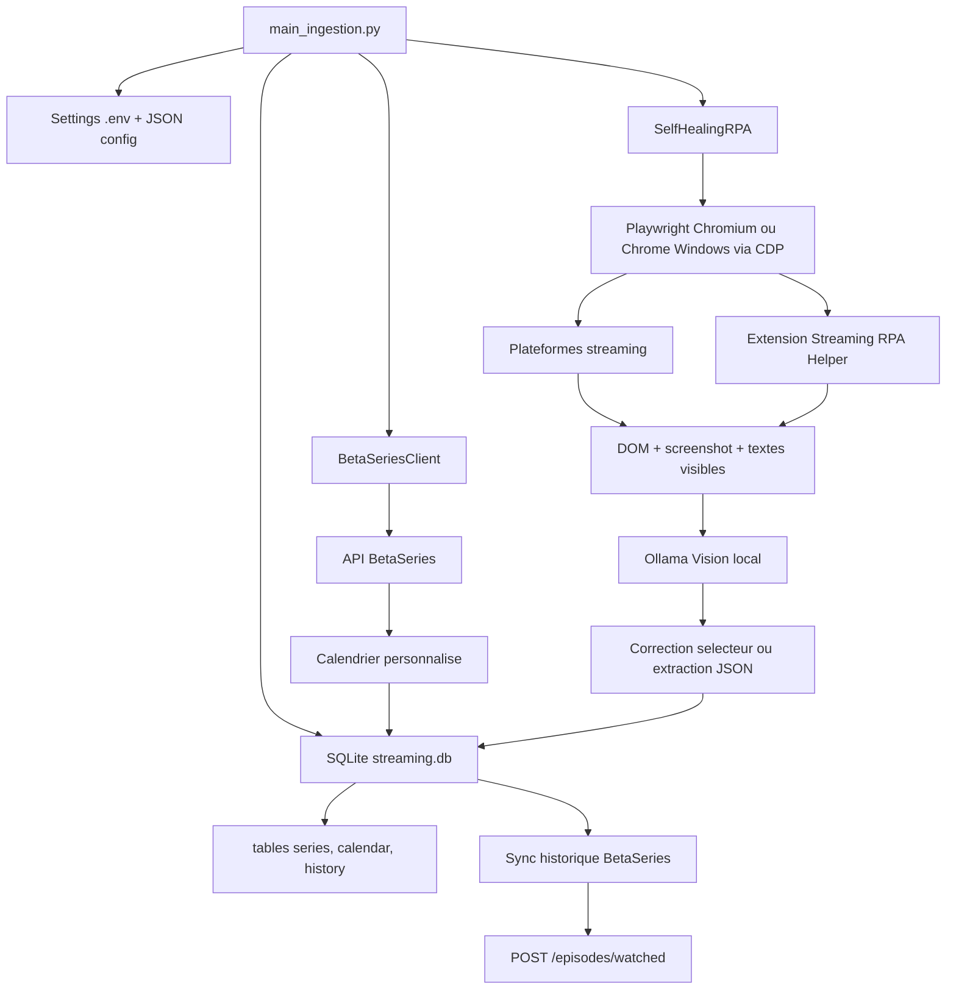

# Architecture

## Schema de flux



## Plan d'architecture

### Couche orchestration

`main_ingestion.py` initialise la configuration, crée le schéma SQLite, lance BetaSeries puis les connecteurs RPA. Les pauses entre flux évitent les enchaînements trop agressifs.

### Couche stockage

`ingestion/db.py` fournit une API SQLite simple:

- `series`: référentiel local des séries.
- `calendar`: épisodes planifiés via BetaSeries.
- `history`: épisodes vus par plateforme.

La table `history` contient les champs demandés: `id`, `serie_id`, `saison`, `episode`, `date_vu`, `plateforme_source`, avec des colonnes de traçabilité (`raw_title`, `confidence`, `created_at`).

Elle contient aussi des champs de synchronisation BetaSeries: `betaseries_episode_id`, `sync_status`, `betaseries_synced_at` et `sync_error`. Ces champs permettent de garder une trace claire entre ce qui a été vu sur les plateformes, ce qui a été reconnu localement et ce qui a réellement été envoyé à BetaSeries.

### Couche BetaSeries

`ingestion/betaseries_client.py` appelle l'API officielle BetaSeries et upsert les épisodes du calendrier personnalisé. Les valeurs nécessaires sont dans `BETASERIES_CONFIG_FILE`, par défaut un fichier local comme `config/betaseries.local.json`:

```json
{
  "api_key": "your_betaseries_api_key",
  "client_secret": "your_oauth2_key_or_secret_key",
  "access_token": "",
  "user_id": ""
}
```

`client_secret` correspond à la `oauth2 key` fournie avec la clé API. `access_token` doit être un token membre obtenu après authentification OAuth; la `oauth2 key` ne suffit pas pour les endpoints utilisateur. Si `user_id` est vide, le client tente de résoudre l'utilisateur via `/members/infos`.

Pour obtenir un token utilisateur avec le device flow:

```bash
. .venv/bin/activate
python tools/betaseries_device_auth.py
```

Le script affiche une URL BetaSeries, un code à saisir, puis la valeur du token à recopier dans `config/betaseries.local.json`.

### Couche RPA self-healing

`ingestion/rpa_self_healing.py` utilise Playwright avec un profil persistant dans `.playwright-profile`, ou le contexte Chrome Windows via CDP. Le RPA tente le login avec les credentials présents dans `STREAMING_PLATFORM_CONFIG_FILE`, puis conserve la session navigateur pour limiter les reconnexions interactives.

Apple TV+, Max, Paramount+ et OCS sont accessibles dans l'offre CANAL+ du
compte utilisateur. Ils ne sont donc pas lancés comme des plateformes
indépendantes : le connecteur `canal_plus` collecte les contenus visibles dans
la session CANAL+ et les enregistre avec `plateforme_source=canal_plus`.

En cas d'échec d'un sélecteur:

1. Capture d'écran de la page courante.
2. Extraction du DOM brut.
3. Appel à Ollama local via `http://localhost:11434/api/chat`.
4. Demande d'un nouveau sélecteur au modèle vision.
5. Mise à jour du sélecteur en mémoire et reprise du flux.

### Extension navigateur optionnelle

Le dossier `browser_extension/streaming-rpa-helper` contient une extension Chromium Manifest V3. Elle injecte un content script sur les plateformes très dynamiques pour exposer:

```javascript
window.__STREAMING_RPA_HELPER__.collectCandidates()
```

Le RPA récupère ces candidats DOM et les ajoute au prompt Ollama. L'extension ne sort aucune donnée du navigateur; elle sert uniquement l'exécution Playwright locale.

Le dossier `browser_extension/crunchyroll-token-helper` contient une seconde extension locale optionnelle. Elle capture uniquement le header `Authorization: Basic ...` envoyé par le site Crunchyroll vers `https://beta-api.crunchyroll.com/auth/v1/token`. Ce header est nécessaire si le client embarqué du wrapper Python `CrunchyrollAPI` est désactivé côté Crunchyroll.

Utilisation:

1. Ouvre Chromium ou Chrome.
2. Va dans `chrome://extensions`.
3. Active le mode développeur.
4. Charge le dossier `browser_extension/crunchyroll-token-helper`.
5. Connecte-toi à Crunchyroll.
6. Ouvre le popup de l'extension et copie la valeur `authorization` dans `config/crunchyroll.local.json`.
