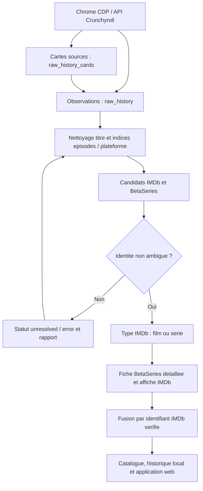

# Vue d’ensemble

## Ingestion unifiee : films et series

Le flux par defaut collecte les films et les series ensemble. `--content-type`
est conserve pour compatibilite, mais ne force plus le type d'une oeuvre.
L'historique brut est conserve avant identification ; une erreur de service ou
un titre ambigu n'efface pas les observations collectees.



Projet personnel d'ingestion locale pour centraliser le calendrier BetaSeries, les séries suivies et les historiques de visionnage issus des plateformes de streaming disponibles en France.

Le projet combine trois approches:

- API officielle BetaSeries pour le calendrier personnalisé, la watchlist et les diffuseurs.
- API non officielles quand elles sont réalistes et maintenues, notamment Crunchyroll.
- RPA Playwright self-healing pour les plateformes sans API exploitable.

Disney+ collecte uniquement les cartes du rail « Continuer à regarder », avec
leur titre complet, les libelles accessibles et le lien de lecture. Les
recommandations et marques de la page d'accueil ne constituent pas un
historique. Un titre Ollama sans correspondance verifiable est ignore avec un
avertissement; les autres titres valides sont conserves. Une carte « Episode
suivant » ne confirme pas le visionnage de cet episode : son numero reste
inconnu. Cette collecte fournit un etat de reprise, pas un historique exhaustif.

CANAL+ collecte les cartes du rail « Continuer la lecture », y compris les
contenus disponibles via Apple TV+, Max, Paramount+ et OCS dans cette session.
La playlist et les recommandations ne sont pas interpretees comme du visionnage.
Les rails Disney+ et CANAL+ utilisent `rpa.strict_history_scope=true` : une
reparation des lignes doit rester dans leur conteneur verifie. Une absence de
rail ne declenche pas une extraction generale des liens de l'accueil. Les titres
vides ou non verifiables sont ignores individuellement. Si la capture d'ecran
depasse 15 secondes, le DOM est tout de meme enregistre pour l'extraction texte.

Crunchyroll cible `.history-body` et les cartes `history-playable-card` de la
liste virtualisee. L'attente utilise `selector_state=attached`, puis les
titres des liens de series, les titres d'episodes et la date de chaque carte
sont lus dans le DOM. La date affichee est convertie de JJ/MM/AAAA en ISO; le
numero E4 est conserve comme episode 4. Si la saison n'est pas indiquee, elle
reste inconnue. Les liens de lecture sont conserves. Le collecteur defile dans
la liste virtualisee et conserve les cartes avant qu'elles ne quittent le DOM.
Il s'arrete au bas de la liste apres trois passages sans nouvelle carte.
`rpa.max_scroll_steps` (500) borne le parcours et `rpa.scroll_wait_ms` (750)
laisse charger les cartes. Si la limite est atteinte, un avertissement signale
une collecte partielle; augmenter ces valeurs dans la configuration si besoin.
Les cartes Crunchyroll sont extraites directement du DOM, sans interpretation
Ollama. L'identifiant de serie, les anciens titres et les liens d'episodes
permettent de conserver le rattachement apres un renommage BetaSeries.

La fiche affiche « Episodes vus X sur Y » : X compte les episodes distincts,
pas les relectures; les lectures en cours restent visibles dans l'historique
sans augmenter X. Y provient des metadonnees `episodes_count` BetaSeries.
Sans total disponible, la fiche indique « total inconnu ». Une serie suivie
mais jamais visionnee peut legitimement ne pas avoir d'historique.

Reparation locale depuis les captures HTML deja enregistrees, sans connexion
aux plateformes ni synchronisation BetaSeries :

```bash
python -m tools.repair_crunchyroll_history          # previsualisation
python -m tools.repair_crunchyroll_history --apply  # sauvegarde puis import
```

L'outil requiert Chromium Playwright (`python -m playwright install chromium`).
La sauvegarde SQLite est creee dans `backups/` avant toute modification.

Execution RPA Crunchyroll seule, sans synchronisation BetaSeries :

```bash
python main_ingestion.py --platform crunchyroll \
  --cdp-url http://127.0.0.1:9222 --skip-betaseries --skip-crunchyroll-api
```

Puis enrichir les nouvelles fiches pour obtenir le total d'episodes et les
titres BetaSeries (ne marque aucun episode comme vu sur le compte distant) :

```bash
python -m tools.enrich_betaseries_metadata --platform crunchyroll --limit 500 --skip-calendar
```

Redemarrer le serveur web s'il a ete lance sans rechargement automatique :

```bash
flask --app web_app run --host 127.0.0.1 --port 5000
```

Execution du connecteur API Crunchyroll seul :

```bash
python main_ingestion.py --platform crunchyroll --skip-rpa --skip-betaseries
```
