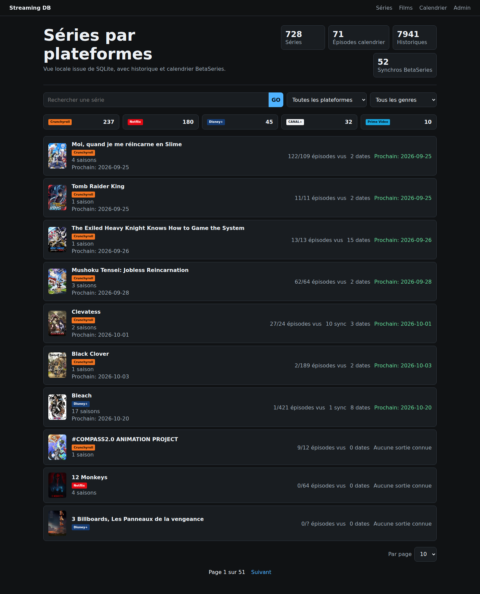
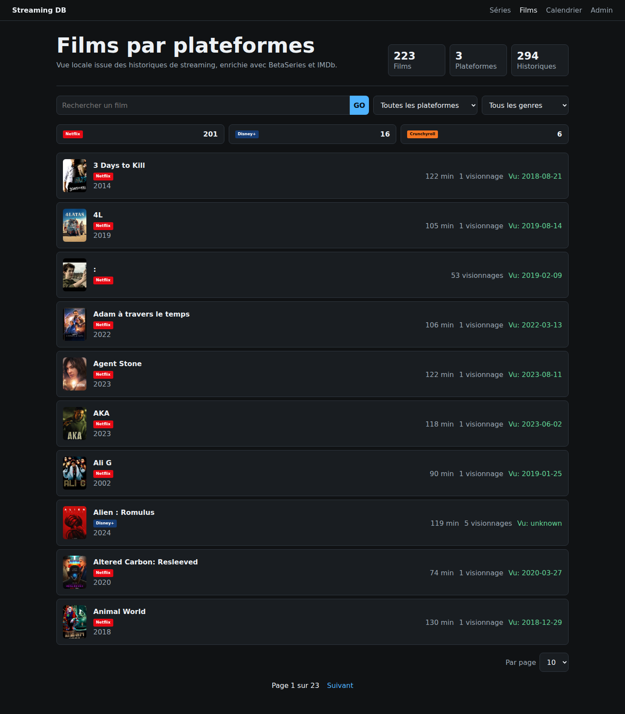
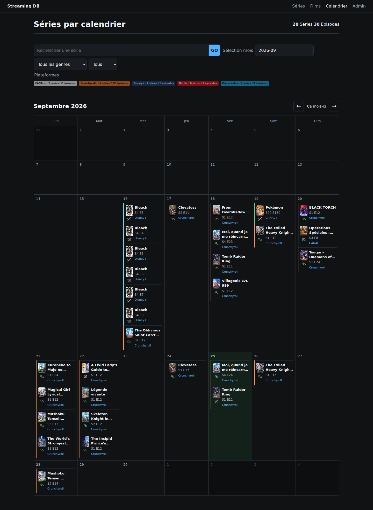
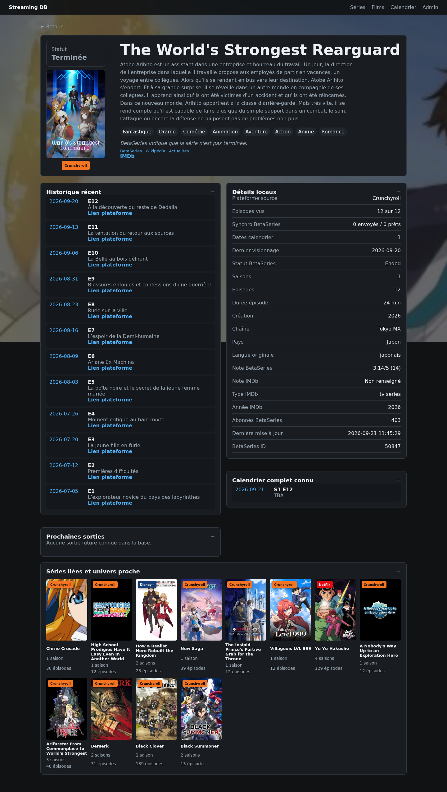

# Application web et administration

## Captures d'écran

### Accueil séries



### Films



### Calendrier



### Détail d'une série



## Calendrier web

La vue `/calendar` affiche l'historique complet des sorties connues dans
SQLite, par mois. Chaque episode porte un indicateur `vu` calcule depuis la
table `history`. Le filtre de visionnage permet d'afficher toutes les sorties,
uniquement les episodes vus ou uniquement les episodes non vus. Les cases a
cocher permettent de combiner plusieurs plateformes; sans selection, toutes
sont affichees. Les filtres sont conserves lors du passage au mois precedent
ou suivant. Chaque episode ouvre la fiche de sa serie.
Sur mobile, les sorties sont regroupees par jour plutot que dans une grille.
Les episodes sans date ne sont pas affiches. La date du jour utilise le fuseau
Europe/Paris. Les dates sont celles du calendrier
enregistre, pas une garantie de disponibilite locale sur la plateforme.

Cette vue ne lance aucune synchronisation. Pour voir de nouvelles dates,
mettre a jour le calendrier via l'ingestion BetaSeries existante puis
actualiser la page. Redemarrer Flask apres une modification du code si le
serveur tourne sans rechargement automatique.

## Administration et suppression

La page `/admin` permet de supprimer une série de la base locale. Elle est
protégée par une authentification HTTP Basic (`admin` + `ADMIN_TOKEN` défini
dans `.env`). La confirmation exige de saisir `SUPPRIMER`; une copie SQLite horodatée est
créée dans `backups/` avant l'opération. Cette action ne modifie aucun compte
de streaming et ne désabonne pas la série de BetaSeries.

La même page expose aussi une zone `Delete Data`. Elle supprime toutes les
données locales d'ingestion (séries, films, calendrier, historique, alias,
sources et cartes brutes) uniquement après saisie exacte de `DELETE`. Une
sauvegarde SQLite horodatée est créée dans `backups/` avant la purge.

La page `/admin/profiles` centralise les réglages multi-profils :

- création ou remplacement d'un méta-profil applicatif ;
- association d'un nom de profil par plateforme ;
- consultation de la matrice des profils plateforme exposée à l'application
  mobile ;
- réglage du seuil d'alerte de synchronisation mobile, avec `24` heures par
  défaut.

La page `/admin/rpa` présente uniquement les plateformes RPA activées. Les
actions de relance sont affichées deux par ligne et les plateformes absentes ou
désactivées dans la configuration ne sont pas proposées.
Chaque relance admin est lancée en mode différentiel et ciblée sur le profil
actif sélectionné dans l'interface, via `--profile-key`. Elle ne parcourt donc
pas toute la matrice des profils par défaut.

Pour demander la suppression de l'historique sur les plateformes connectées,
le script RPA fonctionne en aperçu par défaut. Il ouvre les pages configurées,
repère les cartes dont le titre correspond exactement au titre fourni, et
enregistre une capture HTML. Aucun bouton n'est cliqué en mode aperçu :

```bash
python -m tools.delete_series_history_rpa \
  --title "Clevatess" \
  --platform crunchyroll \
  --cdp-url http://127.0.0.1:9222
```

Après vérification des artefacts dans `artifacts/rpa/delete-history/`, une
suppression distante peut être demandée ainsi :

```bash
python -m tools.delete_series_history_rpa \
  --title "Clevatess" \
  --platform crunchyroll \
  --cdp-url http://127.0.0.1:9222 \
  --apply --confirm-title "Clevatess"
```

Répéter `--platform` pour plusieurs services. Les plateformes ne proposant
pas de bouton de suppression identifiable sont signalées et ignorées; le
script ne supprime pas une carte simplement parce qu'elle contient un lien.
Cette opération dépend de l'interface et des droits du compte, et ne garantit
pas l'effacement côté fournisseur. Le script exclut Arte, conformément à la
configuration active.

```text
.
├── browser_extension/
│   └── streaming-rpa-helper/
│       ├── content.js
│       └── manifest.json
├── config/
│   ├── betaseries.example.json
│   ├── crunchyroll.example.json
│   ├── ollama.example.json
│   ├── platforms.example.json
│   ├── streaming_platform_config.example.json
│   ├── streaming_platforms.example.json
│   ├── streaming_profiles.example.json
│   └── platforms/
│       ├── apple_tv_plus.json
│       ├── arte_tv.json
│       ├── canal_plus.json
│       ├── crunchyroll.json
│       ├── disney_plus.json
│       ├── max.json
│       ├── netflix.json
│       ├── ocs.json
│       ├── paramount_plus.json
│       └── prime_video.json
├── ingestion/
│   ├── betaseries_client.py
│   ├── db.py
│   ├── ollama_client.py
│   ├── rpa_self_healing.py
│   └── settings.py
├── .env
├── .env.example
├── main_ingestion.py
└── requirements.txt
```
